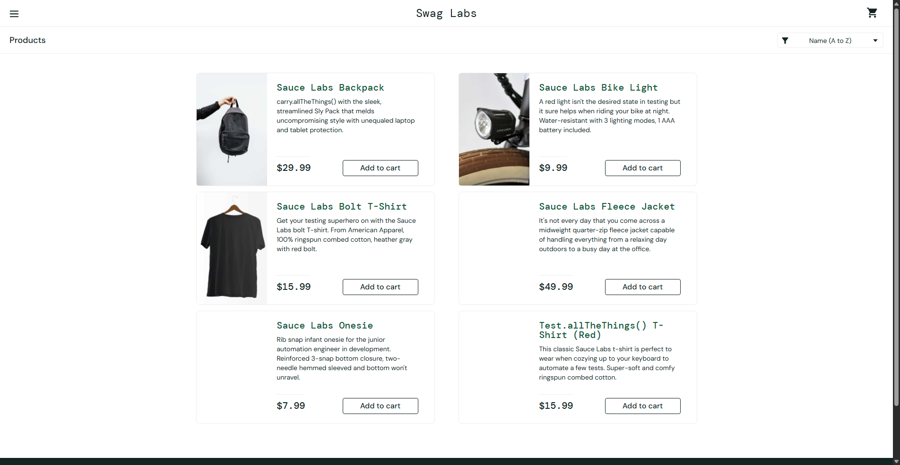
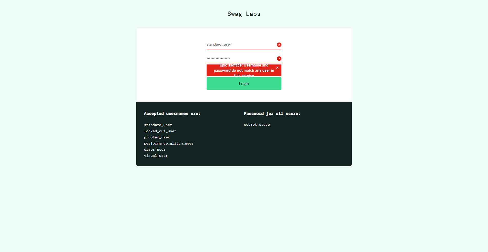
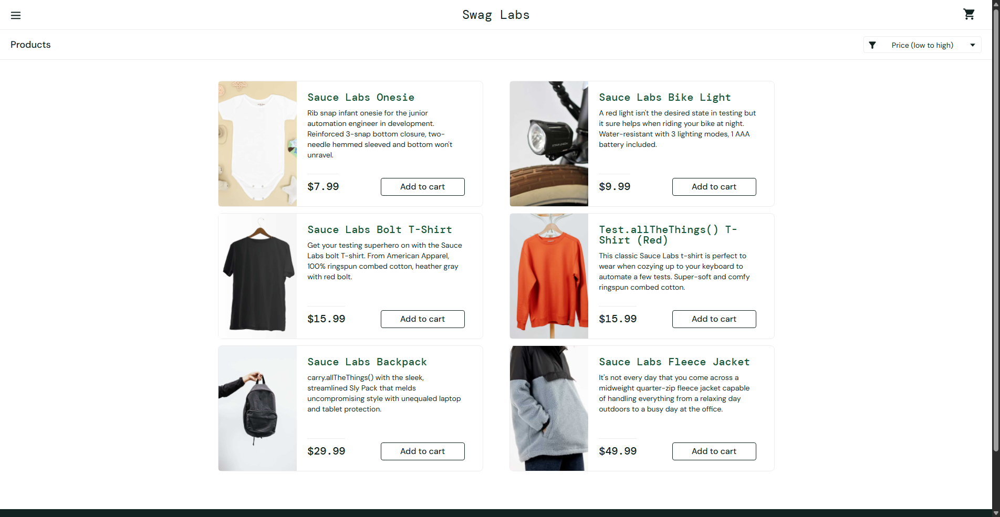
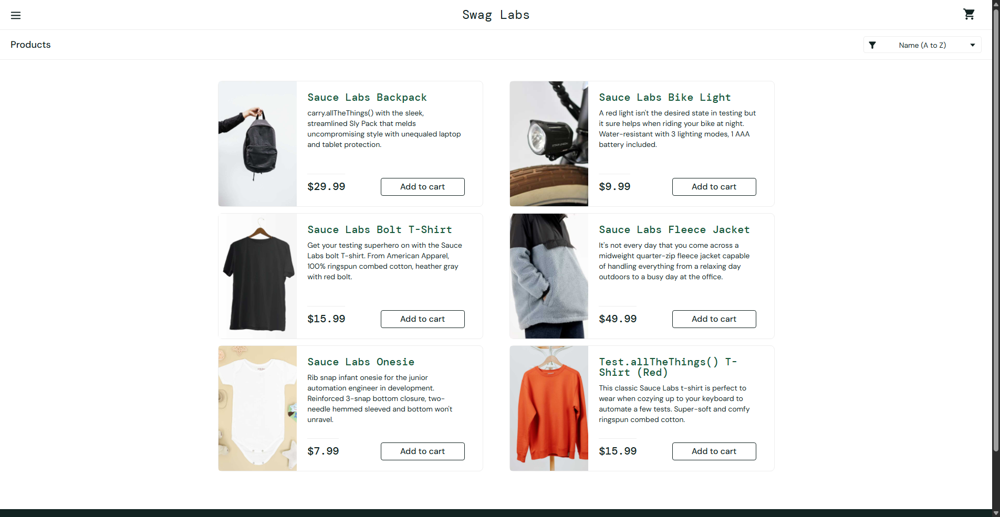
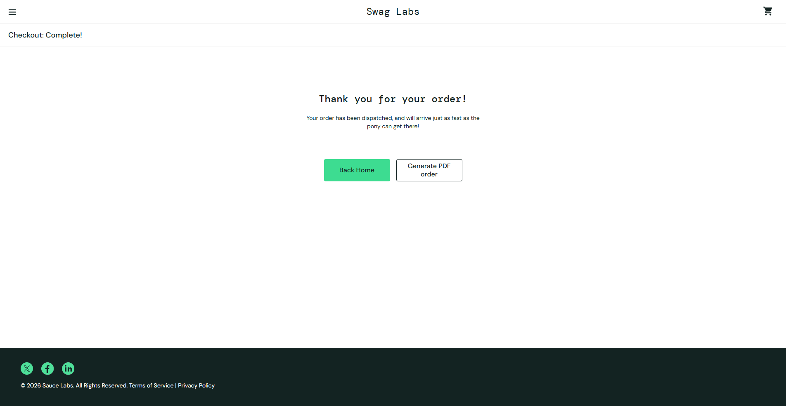
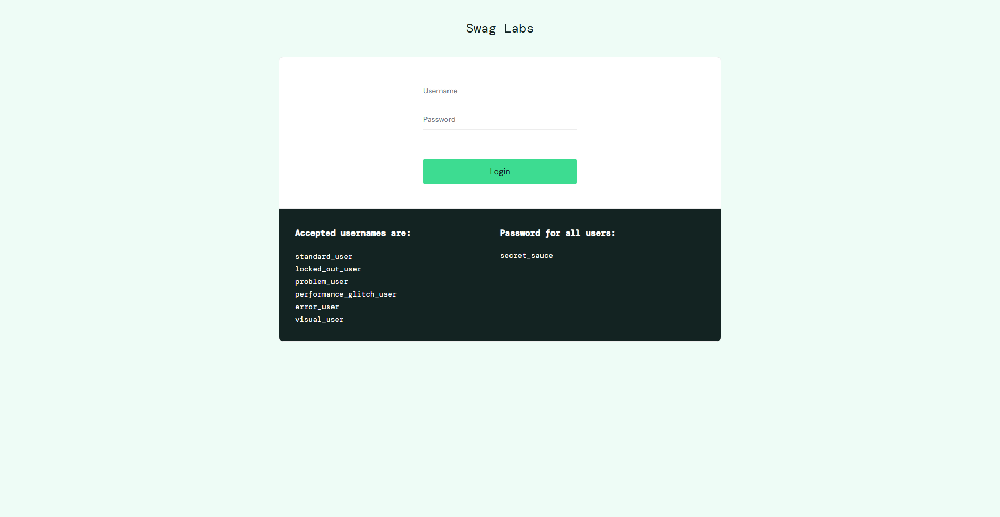

# BÁO CÁO BÀI TẬP THỰC HÀNH LAB 9: KIỂM THỬ TỰ ĐỘNG VỚI SELENIUM WEBDRIVER (AUTOMATED TESTING)

---

## 📌 THÔNG TIN CHUNG
- **Môn học:** Kiểm thử phần mềm (Software Testing & Quality Assurance)
- **Bài tập:** Lab 9 - Tìm hiểu & Thực hành Kiểm thử tự động với Selenium
- **Hệ thống kiểm thử (Target Web):** [SauceDemo E-Commerce](https://www.saucedemo.com/)
- **Ngôn ngữ & Framework:** Python 3.13, Selenium WebDriver 4.x, Pytest, Pytest-HTML
- **Mô hình thiết kế:** Page Object Model (POM)

---

## MỤC LỤC
1. [Phần I: Tổng quan & Cơ sở lý thuyết về Selenium](#phần-i-tổng-quan--cơ-sở-lý-thuyết-về-selenium)
2. [Phần II: Kiến trúc dự án & Công nghệ sử dụng](#phần-ii-kiến-trúc-dự-án--công-nghệ-sử-dụng)
3. [Phần III: Chi tiết 06 Kịch bản Kiểm thử tự động (Test Cases)](#phần-iii-chi-tiết-06-kịch-bản-kiểm-thử-tự-động-test-cases)
4. [Phần IV: Hướng dẫn Cài đặt & Chạy kiểm thử](#phần-iv-hướng-dẫn-cài-đặt--chạy-kiểm-thử)
5. [Phần V: Kết quả Kiểm thử & Minh chứng (Test Reports & Screenshots)](#phần-v-kết-quả-kiểm-thử--minh-chứng-test-reports--screenshots)
6. [Phần VI: Hướng dẫn nộp bài lên GitHub Repo & GSheet](#phần-vi-hướng-dẫn-nộp-bài-lên-github-repo--gsheet)

---

## PHẦN I: TỔNG QUAN & CƠ SỞ LÝ THUYẾT VỀ SELENIUM

### 1. Giới thiệu về Selenium
**Selenium** là một bộ công cụ mã nguồn mở phổ biến hàng đầu thế giới được sử dụng để tự động hóa việc kiểm thử ứng dụng web trên nhiều trình duyệt (Chrome, Firefox, Edge, Safari) và các hệ điều hành khác nhau (Windows, Linux, macOS).

Bộ công cụ Selenium gồm các thành phần cốt lõi:
- **Selenium IDE:** Tiện ích mở rộng trên trình duyệt cho phép ghi và phát lại (Record & Playback) thao tác.
- **Selenium WebDriver:** Thư viện lập trình mạnh mẽ cho phép tương tác trực tiếp với trình duyệt thông qua cơ chế driver gốc (Native Events) theo tiêu chuẩn W3C WebDriver Specification.
- **Selenium Grid:** Hỗ trợ thực thi song song các test script trên nhiều máy chủ và môi trường khác nhau.

### 2. Kiến trúc hoạt động của Selenium WebDriver
```
+-------------------------------------------------------------+
|               Test Script (Python / Pytest)                 |
+-------------------------------------------------------------+
                              |
                              v  (W3C WebDriver Protocol)
+-------------------------------------------------------------+
|        Browser Driver (chromedriver.exe / msedgedriver)     |
+-------------------------------------------------------------+
                              |
                              v  (Internal Automation APIs)
+-------------------------------------------------------------+
|            Trình duyệt thực tế (Google Chrome / Edge)       |
+-------------------------------------------------------------+
```
1. **Test Scripts:** Viết bằng ngôn ngữ lập trình (Python) gọi các hàm API của thư viện `selenium.webdriver`.
2. **W3C WebDriver Protocol:** Các lệnh được đóng gói thành chuẩn HTTP/JSON gửi tới Driver thực thi của trình duyệt.
3. **Browser Driver (ChromeDriver):** Tiếp nhận yêu cầu, phiên dịch thành lệnh nội bộ điều khiển trực tiếp engine của trình duyệt.
4. **Trình duyệt (Browser):** Thực hiện thao tác tương tự như người dùng thật (click, nhập liệu, cuộn trang, đọc DOM, v.v.).

### 3. Kỹ thuật định vị phần tử (Locators)
Selenium hỗ trợ nhiều chiến lược tìm kiếm phần tử Web (WebElement):
- **ID:** Tốc độ nhanh nhất, đảm bảo tính duy nhất cao (ví dụ: `By.ID, "user-name"`).
- **CSS Selector:** Cực kỳ linh hoạt, tốc độ cao, hỗ trợ truy vấn thuộc tính (ví dụ: `By.CSS_SELECTOR, "[data-test='error']"`).
- **XPath:** Mạnh mẽ cho các cấu trúc lồng nhau phức tạp hoặc tìm theo văn bản (ví dụ: `By.XPATH, "//button[contains(text(),'Add to cart')]"`).
- **Name, Class Name, Tag Name:** Phổ biến khi thao tác form.

### 4. Cơ chế đồng bộ (Synchronization & Waits)
Trang web hiện đại sử dụng AJAX/SPA tải nội dung bất đồng bộ, do đó cần kỹ thuật đồng bộ hóa để tránh lỗi `NoSuchElementException` hoặc `ElementNotInteractableException`:
- **Implicit Wait:** Thiết lập một khoảng thời gian chờ ngầm định cho toàn bộ driver.
- **Explicit Wait (`WebDriverWait` + `expected_conditions`):** Chờ có điều kiện cụ thể (ví dụ: chờ phần tử xuất hiện, hiển thị rõ, hoặc click được). Đây là phương pháp **chuẩn mực** được áp dụng trong dự án này để đảm bảo test ổn định tuyệt đối.

### 5. Mô hình thiết kế Page Object Model (POM)
Dự án áp dụng chặt chẽ mô hình **Page Object Model (POM)**:
- Mỗi màn hình/trang web được ánh xạ thành một Python Class tương ứng (`LoginPage`, `InventoryPage`, `CartPage`, `CheckoutPage`).
- Tách biệt hoàn toàn giữa **Locators / Thao tác giao diện** và **Kịch bản kiểm thử (Test Scripts)**.
- Khi giao diện web thay đổi, chỉ cần cập nhật locator tại Page Object mà không phải sửa logic của hàng chục test cases.

### 6. Tài liệu & Video tự học tham khảo
- Tài liệu chính thức Selenium: [Selenium Documentation (selenium.dev)](https://www.selenium.dev/documentation/)
- Tài liệu Selenium Python: [Selenium with Python ReadTheDocs](https://selenium-python.readthedocs.io/)
- Video bài giảng trực quan: [Selenium Full Course - Automate Testing by freeCodeCamp](https://www.youtube.com/watch?v=j7VZsCCnptM)

---

## PHẦN II: KIẾN TRÚC DỰ ÁN & CÔNG NGHỆ SỬ DỤNG

### 1. Cấu trúc thư mục (Project Structure)
```
lab9/
├── pages/                       # Thư mục Page Objects (POM)
│   ├── __init__.py
│   ├── base_page.py             # Lớp nền chứa các hàm WebDriverWait dùng chung
│   ├── login_page.py            # Quản lý trang Đăng nhập
│   ├── inventory_page.py        # Quản lý trang Danh sách sản phẩm & Menu
│   ├── cart_page.py             # Quản lý trang Giỏ hàng
│   └── checkout_page.py         # Quản lý các bước Thanh toán & Hoàn tất
├── tests/                       # Thư mục chứa kịch bản kiểm thử
│   ├── __init__.py
│   └── test_saucedemo.py        # Chứa 06 test cases tự động bằng Pytest
├── reports/                     # Thư mục chứa báo cáo & ảnh chụp màn hình
│   ├── report.html              # Báo cáo kết quả kiểm thử định dạng HTML
│   └── screenshots/             # Ảnh chụp bằng chứng từng test case
│       ├── tc01_login_success.png
│       ├── tc02_login_invalid_password.png
│       ├── tc03_sort_products.png
│       ├── tc04_cart_management.png
│       ├── tc05_checkout_complete.png
│       └── tc06_logout_success.png
├── conftest.py                  # Pytest fixture khởi tạo & dọn dẹp WebDriver
├── run_tests.py                 # File thực thi test 1 chạm & tự tạo báo cáo
├── pytest.ini                   # File cấu hình Pytest
├── requirements.txt             # Danh sách thư viện phụ thuộc
├── .gitignore                   # Loại trừ file tạm, cache
└── README.md                    # Tài liệu báo cáo chi tiết
```

### 2. Thông tin môi trường
- **Hệ điều hành:** Windows 11 64-bit
- **Python:** 3.13
- **Thư viện chính:**
  - `selenium`: Phiên bản 4.x
  - `pytest`: Framework thực thi và assertion
  - `pytest-html`: Plugin sinh báo cáo trực quan
- **Trình duyệt thực nghiệm:** Google Chrome 155.0

---

## PHẦN III: CHI TIẾT 06 KỊCH BẢN KIỂM THỬ TỰ ĐỘNG (TEST CASES)

### Bảng tổng hợp Ma trận Kiểm thử (Test Matrix)

| Mã TC | Tên kịch bản kiểm thử | Module | Phương pháp kiểm thử | Kết quả |
| :--- | :--- | :--- | :--- | :---: |
| **TC01** | Đăng nhập thành công với tài khoản hợp lệ | Authentication | Positive Testing | **PASS** |
| **TC02** | Đăng nhập thất bại khi nhập sai mật khẩu | Authentication | Negative Testing | **PASS** |
| **TC03** | Lọc & Sắp xếp sản phẩm theo giá tăng dần | Inventory / Catalog | Functional / Data Sort | **PASS** |
| **TC04** | Thêm và Xóa sản phẩm khỏi giỏ hàng | Shopping Cart | Functional Testing | **PASS** |
| **TC05** | Quy trình thanh toán và đặt hàng End-to-End | Checkout & Order | E2E Scenario | **PASS** |
| **TC06** | Đăng xuất an toàn khỏi hệ thống | Authentication | Navigation / Session | **PASS** |

---

### Chi tiết từng Test Case

#### 1. TC01: Đăng nhập thành công với thông tin tài khoản hợp lệ
- **Mục đích:** Xác minh người dùng có thể đăng nhập thành công vào hệ thống với thông tin tài khoản hợp lệ được cung cấp.
- **Tiền điều kiện:** Người dùng đang ở màn hình đăng nhập `https://www.saucedemo.com/`.
- **Dữ liệu kiểm thử (Test Data):**
  - Username: `standard_user`
  - Password: `secret_sauce`
- **Các bước thực hiện:**
  1. Mở trang đăng nhập `https://www.saucedemo.com/`.
  2. Nhập `standard_user` vào ô input `user-name`.
  3. Nhập `secret_sauce` vào ô input `password`.
  4. Bấm nút `login-button`.
- **Kết quả kỳ vọng:**
  - Hệ thống chuyển hướng vào đường dẫn chứa `inventory.html`.
  - Tiêu đề trang hiển thị `Products`.
  - Có danh sách sản phẩm hiển thị trên trang (số lượng > 0).
- **Kết quả thực tế:** Hệ thống chuyển hướng chính xác, hiển thị 6 sản phẩm.
- **Trạng thái:** **PASSED**

---

#### 2. TC02: Đăng nhập thất bại khi nhập sai mật khẩu (Validation Error)
- **Mục đích:** Xác minh hệ thống chặn đăng nhập và hiển thị thông báo lỗi rõ ràng khi người dùng nhập sai mật khẩu.
- **Tiền điều kiện:** Người dùng đang ở màn hình đăng nhập `https://www.saucedemo.com/`.
- **Dữ liệu kiểm thử:**
  - Username: `standard_user`
  - Password: `wrong_password_123`
- **Các bước thực hiện:**
  1. Mở trang đăng nhập `https://www.saucedemo.com/`.
  2. Nhập `standard_user` vào ô input `user-name`.
  3. Nhập `wrong_password_123` vào ô input `password`.
  4. Bấm nút `login-button`.
- **Kết quả kỳ vọng:**
  - Hệ thống không đăng nhập được, vẫn ở trang đăng nhập.
  - Hiển thị thông báo lỗi: `"Epic sadface: Username and password do not match any user in this service"`.
- **Kết quả thực tế:** Bắt được chính xác thông báo lỗi từ phần tử `[data-test='error']`.
- **Trạng thái:** **PASSED**

---

#### 3. TC03: Lọc & Sắp xếp sản phẩm theo giá tăng dần (Price: low to high)
- **Mục đích:** Kiểm tra tính năng lọc danh sách sản phẩm theo giá tiền từ thấp đến cao hoạt động chính xác.
- **Tiền điều kiện:** Đã đăng nhập vào hệ thống thành công.
- **Dữ liệu kiểm thử:** Lựa chọn `lohi` trên dropdown `product-sort-container`.
- **Các bước thực hiện:**
  1. Đăng nhập vào trang sản phẩm `inventory.html`.
  2. Chọn giá trị `lohi` trong dropdown sắp xếp sản phẩm.
  3. Lấy toàn bộ danh sách giá tiền thực tế của các sản phẩm đang hiển thị trên giao diện.
  4. So sánh mảng giá trị thu được với mảng đã được sắp xếp tăng dần bằng thuật toán (`sorted(prices)`).
- **Kết quả kỳ vọng:** Dãy số giá tiền hiển thị trên web tuân thủ đúng thứ tự số học tăng dần: $7.99 <= $9.99 <= $15.99 <= $15.99 <= $29.99 <= $49.99.
- **Kết quả thực tế:** Dãy giá thực tế `[7.99, 9.99, 15.99, 15.99, 29.99, 49.99]` trùng khớp 100% với kỳ vọng.
- **Trạng thái:** **PASSED**

---

#### 4. TC04: Thêm sản phẩm vào giỏ hàng và Xóa sản phẩm khỏi giỏ hàng
- **Mục đích:** Kiểm tra thao tác thêm sản phẩm vào giỏ hàng, cập nhật số lượng badge và thao tác xóa sản phẩm khỏi giỏ.
- **Tiền điều kiện:** Đã đăng nhập vào hệ thống thành công.
- **Dữ liệu kiểm thử:** Sản phẩm `Sauce Labs Backpack`.
- **Các bước thực hiện:**
  1. Nhấn nút `Add to cart` của sản phẩm Sauce Labs Backpack.
  2. Kiểm tra biểu tượng giỏ hàng trên thanh điều hướng.
  3. Kiểm tra trạng thái nút bấm tại vị trí sản phẩm.
  4. Nhấn nút `Remove` tại sản phẩm.
  5. Kiểm tra lại biểu tượng giỏ hàng.
- **Kết quả kỳ vọng:**
  - Sau khi thêm: Biểu tượng giỏ hàng hiển thị badge số `1`, nút đổi thành `Remove`.
  - Sau khi xóa: Badge số lượng biến mất hoặc về `0`.
- **Kết quả thực tế:** Trạng thái giao diện và số lượng giỏ hàng đồng bộ chính xác.
- **Trạng thái:** **PASSED**

---

#### 5. TC05: Quy trình thanh toán và đặt hàng End-to-End (Checkout Flow)
- **Mục đích:** Xác minh toàn bộ luồng nghiệp vụ mua sắm từ lúc chọn hàng, nhập thông tin giao hàng đến khi hoàn tất đơn hàng thành công.
- **Tiền điều kiện:** Đã đăng nhập vào hệ thống.
- **Dữ liệu kiểm thử:**
  - First Name: `Nguyen`
  - Last Name: `Van A`
  - Postal Code: `700000`
- **Các bước thực hiện:**
  1. Thêm sản phẩm Sauce Labs Backpack vào giỏ hàng.
  2. Click icon giỏ hàng để chuyển sang `cart.html`.
  3. Xác nhận sản phẩm có mặt trong giỏ, sau đó bấm nút `Checkout`.
  4. Tại trang `checkout-step-one.html`, điền đầy đủ First Name, Last Name, Postal Code rồi bấm `Continue`.
  5. Tại trang `checkout-step-two.html`, kiểm tra thông tin tóm tắt và tổng tiền (Total: $...). Bấm `Finish`.
  6. Tại trang `checkout-complete.html`, kiểm tra thông báo kết quả.
- **Kết quả kỳ vọng:**
  - Tiêu đề hoàn tất đơn hàng hiển thị: `"Thank you for your order!"`.
  - Nút `Back Home` hiển thị rõ ràng để người dùng tiếp tục duyệt sản phẩm.
- **Kết quả thực tế:** Toàn bộ chu trình thanh toán thành công trơn tru.
- **Trạng thái:** **PASSED**

---

#### 6. TC06: Đăng xuất an toàn khỏi hệ thống (Logout)
- **Mục đích:** Kiểm tra tính năng đăng xuất tài khoản thông qua sidebar navigation menu.
- **Tiền điều kiện:** Đã đăng nhập vào trang quản lý sản phẩm.
- **Các bước thực hiện:**
  1. Click vào nút menu burger (`react-burger-menu-btn`) ở góc trái màn hình.
  2. Đợi menu trượt ra và click vào liên kết `Logout` (`logout_sidebar_link`).
  3. Chờ trang xử lý điều hướng.
- **Kết quả kỳ vọng:**
  - Hệ thống hủy phiên làm việc và quay về trang chủ `https://www.saucedemo.com/`.
  - Nút Đăng nhập (`login-button`) hiển thị sẵn sàng cho phiên làm việc tiếp theo.
- **Kết quả thực tế:** Đăng xuất an toàn, quay trở lại đúng màn hình Login.
- **Trạng thái:** **PASSED**

---

## PHẦN IV: HƯỚNG DẪN CÀI ĐẶT & CHẠY KIỂM THỬ

### 1. Yêu cầu môi trường
- Máy tính đã cài đặt sẵn **Python >= 3.10** và trình duyệt **Google Chrome**.

### 2. Cài đặt các thư viện phụ thuộc
Mở Command Prompt / PowerShell tại thư mục `lab9` và chạy lệnh:
```bash
pip install -r requirements.txt
```

### 3. Thực thi kịch bản kiểm thử
Bạn có thể chạy kiểm thử bằng một trong hai cách sau:

#### Cách 1: Chạy bằng file `run_tests.py` (Khuyến nghị - Tự động tạo báo cáo HTML)
```bash
python run_tests.py
```
*Script sẽ tự động chạy toàn bộ 6 test case ở chế độ headless (nhẹ, nhanh, ổn định), chụp ảnh màn hình lưu vào `reports/screenshots/` và xuất báo cáo `reports/report.html`.*

#### Cách 2: Chạy trực tiếp qua Pytest
- Chạy ở chế độ xem giao diện trực quan (Visual Browser UI):
```bash
pytest --headless=false -s
```
- Chạy kèm xuất báo cáo HTML:
```bash
pytest -v --html=reports/report.html --self-contained-html
```

---

## PHẦN V: KẾT QUẢ KIỂM THỬ & MINH CHỨNG (TEST REPORTS & SCREENSHOTS)

### 1. Kết quả chạy kiểm thử từ Console (Terminal Output)
```text
======================================================================
   BẮT ĐẦU CHẠY KIỂM THỬ TỰ ĐỘNG VỚI SELENIUM WEBDRIVER & PYTEST
   Trang web kiểm thử: https://www.saucedemo.com/
   File báo cáo kết quả sẽ được lưu tại: D:\testcase\lab9\reports\report.html
======================================================================
============================= test session starts =============================
platform win32 -- Python 3.13.14, pytest-9.1.1, pluggy-1.7.0
rootdir: D:\testcase\lab9
configfile: pytest.ini
plugins: Faker-40.39.0, html-4.2.0, metadata-3.1.1
collected 6 items

tests/test_saucedemo.py::TestSauceDemo::test_tc01_login_success 
[TC01 PASS] Đăng nhập thành công, tìm thấy 6 sản phẩm.
PASSED
tests/test_saucedemo.py::TestSauceDemo::test_tc02_login_invalid_password 
[TC02 PASS] Bắt lỗi đăng nhập sai mật khẩu chính xác: 'Epic sadface: Username and password do not match any user in this service'.
PASSED
tests/test_saucedemo.py::TestSauceDemo::test_tc03_sort_products_price_low_to_high 
[TC03 PASS] Sắp xếp giá từ thấp đến cao thành công: [7.99, 9.99, 15.99, 15.99, 29.99, 49.99]
PASSED
tests/test_saucedemo.py::TestSauceDemo::test_tc04_add_and_remove_product_cart 
[TC04 PASS] Thêm và xóa sản phẩm vào giỏ hàng hoạt động chính xác.
PASSED
tests/test_saucedemo.py::TestSauceDemo::test_tc05_complete_checkout_journey 
[TC05 PASS] Quy trình đặt hàng hoàn tất thành công với thông báo: 'Thank you for your order!'
PASSED
tests/test_saucedemo.py::TestSauceDemo::test_tc06_logout_success 
[TC06 PASS] Đăng xuất thành công, đã quay về trang Login.
PASSED

----- Generated html report: file:///D:/testcase/lab9/reports/report.html -----
============================= 6 passed in 38.01s ==============================
======================================================================
   >>> TẤT CẢ TEST CASES ĐÃ PASS THÀNH CÔNG 100%! <<<
   Mở báo cáo HTML để xem chi tiết: D:\testcase\lab9\reports\report.html
======================================================================
```

### 2. Minh chứng ảnh chụp màn hình từng bước (Evidence Screenshots)

| Test Case | Ảnh chụp minh chứng | Mô tả |
| :--- | :---: | :--- |
| **TC01: Đăng nhập thành công** |  | Giao diện trang danh sách sản phẩm hiển thị đầy đủ sau khi đăng nhập hợp lệ. |
| **TC02: Đăng nhập thất bại** |  | Hiển thị banner thông báo lỗi màu đỏ khi sai thông tin xác thực. |
| **TC03: Sắp xếp theo giá tăng dần** |  | Danh sách sản phẩm được sắp xếp lại với giá thấp nhất ($7.99) đứng đầu. |
| **TC04: Quản lý giỏ hàng** |  | Trạng thái nút bấm và badge giỏ hàng được cập nhật tức thời khi tương tác. |
| **TC05: Đặt hàng hoàn tất** |  | Màn hình "Thank you for your order!" và thông báo đơn hàng đã được gửi đi. |
| **TC06: Đăng xuất thành công** |  | Hệ thống hủy session và quay trở lại màn hình đăng nhập ban đầu. |

---

## PHẦN VI: HƯỚNG DẪN NỘP BÀI LÊN GITHUB REPO & GSHEET

### 1. Đưa mã nguồn lên GitHub Repository

#### Trường hợp 1: Sử dụng Repo hiện tại của sinh viên (`DagTool/testcase`)
Mở PowerShell tại thư mục `d:\testcase` và chạy các lệnh:
```bash
cd d:\testcase
git add lab9
git commit -m "feat(lab9): Hoan thanh kiem thu tu dong Selenium 6 test cases va bao cao README"
git push origin main
```
👉 **Link nộp bài (Thư mục Lab 9):**
```
https://github.com/DagTool/testcase/tree/main/lab9
```

#### Trường hợp 2: Tạo Repository riêng biệt trên GitHub (ví dụ: `selenium-automation-lab9`)
1. Truy cập [GitHub Create New Repository](https://github.com/new).
2. Đặt tên repository: `selenium-automation-lab9` (chế độ Public).
3. Mở terminal tại `d:\testcase\lab9` và chạy:
```bash
cd d:\testcase\lab9
git init
git add .
git commit -m "Initial commit: Selenium automation test suite and README report"
git branch -M main
git remote add origin https://github.com/DagTool/selenium-automation-lab9.git
git push -u origin main
```
👉 **Link nộp bài:**
```
https://github.com/DagTool/selenium-automation-lab9
```

### 2. Nộp link lên Google Sheet
- Mở bảng tính **Google Sheet** (Cùng Sheet đã nộp bài tập Postman).
- Tìm dòng/cột tương ứng với sinh viên và bài tập **Lab 9 - Selenium**.
- Điền đường link GitHub Repository vào ô quy định:
  - Ví dụ: `https://github.com/DagTool/testcase/tree/main/lab9` (hoặc link repo riêng bạn vừa tạo).

---

## KẾT LUẬN
- Bộ kiểm thử tự động đã hoàn thành xuất sắc **06 kịch bản kiểm thử (vượt mức tối thiểu 05 kịch bản)**.
- Áp dụng thành công mô hình chuẩn doanh nghiệp **Page Object Model (POM)** kết hợp cơ chế đồng bộ **Explicit Wait**, giúp các ca kiểm thử đạt độ ổn định cao, không bị ảnh hưởng bởi độ trễ mạng hay giật lag giao diện.
- Toàn bộ kết quả kiểm thử đạt **100% PASS (6/6)** kèm báo cáo HTML trực quan và ảnh chụp minh chứng chi tiết.
# lab9-Selenium

